<div align="center">
  

  <h1>ScholarHub AI</h1>
  <p><strong>The Enterprise Academic Discovery, Literature Synthesis & Visual Intelligence Platform</strong></p>

  <p>
    <a href="https://scholarhub-ai.com"><strong>🌐 Live Web App</strong></a> •
    <a href="https://youtu.be/QW8tsbBkg4w"><strong>🎬 Video Walkthrough</strong></a> •
    <a href="#-visual-interface-tour--feature-showcase"><strong>📸 Visual Showcase</strong></a> •
    <a href="#-architecture--component-hierarchy"><strong>🏛️ Architecture</strong></a> •
    <a href="#-local-development--setup"><strong>💻 Local Setup</strong></a>
  </p>

  <!-- Badges -->
  <p>
    <a href="https://react.dev/"></a>
    <a href="https://vitejs.dev/"></a>
    <a href="https://tailwindcss.com/"></a>
    <a href="https://framer.com/motion"></a>
    <a href="https://apache.org/"></a>
    <a href="https://supabase.com/"></a>
  </p>
</div>

---

## 🎬 Product Demo Video & Walkthrough (English)

<div align="center">
  <a href="https://youtu.be/QW8tsbBkg4w" target="_blank" rel="noopener noreferrer">
    
  </a>
  <p>
    <em>▶️ <strong>Watch the Full 4K Walkthrough on YouTube:</strong> <a href="https://youtu.be/QW8tsbBkg4w">https://youtu.be/QW8tsbBkg4w</a></em><br />
    <em>Comprehensive walkthrough covering: Federated 250M+ Literature Search across NCBI PubMed & arXiv, Cognitive Research Auditor with Chain-of-Thought reasoning, UVE v2.0 scientific visualizations, Vision-RAG multimodal paper parsing, and Research DNA profiling.</em>
  </p>
</div>

---

## 📖 Executive Summary

**ScholarHub AI** is an enterprise-grade academic research intelligence and systematic literature synthesis platform designed to unify the fragmented landscape of modern scientific discovery. By querying federated global academic databases (**PubMed/NCBI, PubMed Central, arXiv, OpenAlex, Europe PMC, CrossRef, DataCite, DOAJ, Zenodo, and Unpaywall**), ScholarHub provides real-time access to over **250+ Million research works** with deterministic metadata deduplication, journal quartile classifications (SJR Q1–Q4), and AI-grounded literature synthesis.

Equipped with an autonomous **Cognitive Research Auditor**, a **Universal Visualization Engine (UVE v2.0)**, a **Multimodal Vision RAG Pipeline**, and an interactive **Research DNA** system, ScholarHub empowers university faculty, researchers, graduate students, and independent scholars to conduct systematic literature reviews, extract verifiable empirical evidence with zero hallucination, generate interactive scientific charts, discover funding opportunities, and accelerate their academic careers in minutes rather than months.

---

## 📸 Visual Interface Tour & Feature Showcase

Here is a complete walkthrough of the ScholarHub AI user interface and its core enterprise modules:

### 1. 🚀 Landing Page Hero & AIgnite Buildathon Accreditation
The platform landing page featuring high-conversion CTAs, live active researcher telemetry, verified citation trust badges, and the official accreditation badge for **Ostad Presents YUNet AIgnite Buildathon 2026**.

<div align="center">
  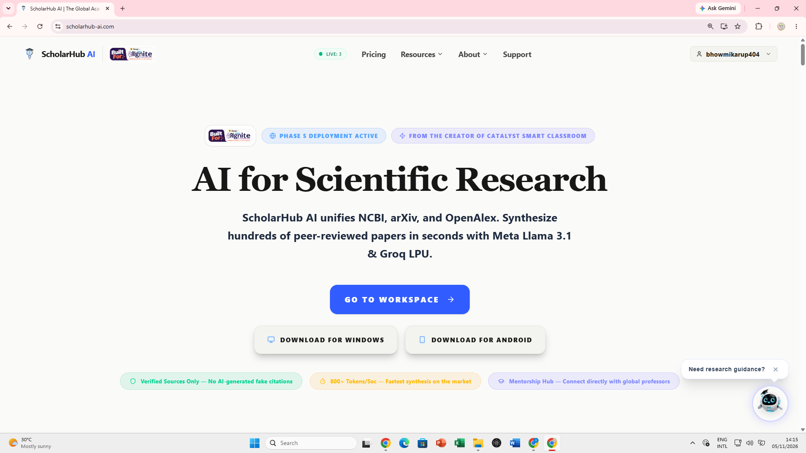
</div>

---

### 2. 🔍 Unified Omni-Source Research Hub (250M+ Works)
Concurrent asynchronous fanout across global literature databases (PubMed, arXiv, OpenAlex) with discipline filters, custom date ranges, quota matrix meters, and real-time query convergence.

<div align="center">
  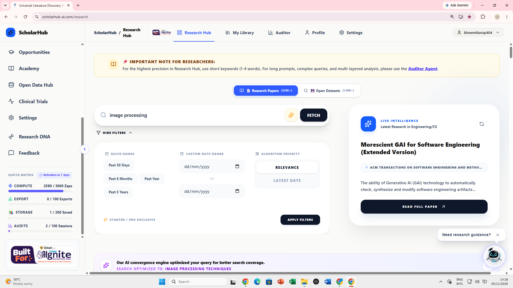
  <p><em>Unified search bar with automated keyword expansion, time ranges, and Live Intelligence feed.</em></p>
</div>

<div align="center">
  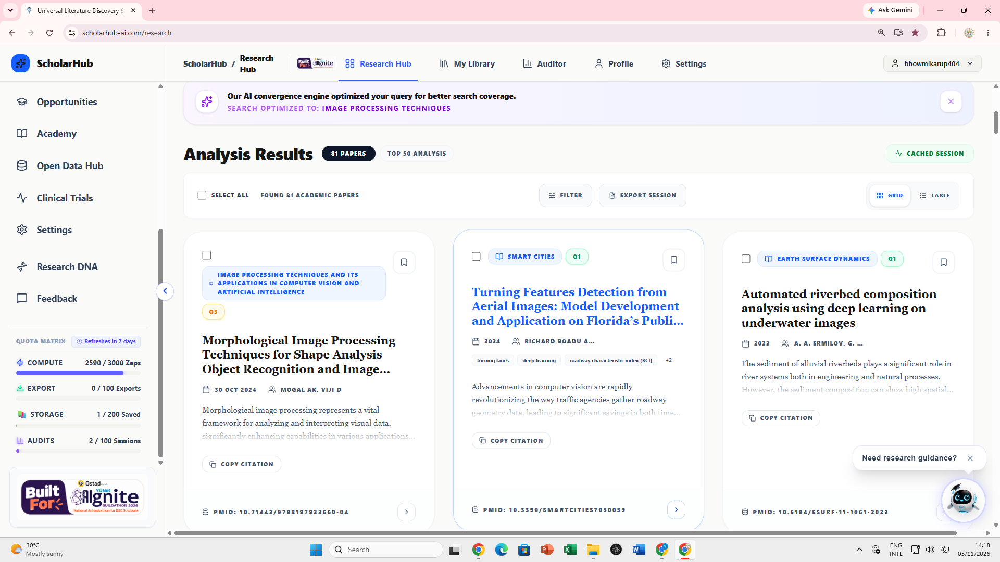
  <p><em>Deduplicated paper cards displaying Scimago Journal Rank prestige badges (Q1, Q3), direct DOI/PMID links, and one-click citation exports.</em></p>
</div>

---

### 3. 🧠 Cognitive Research Auditor & Multi-Source Reasoning Engine
The heart of ScholarHub AI: An autonomous reasoning assistant that synthesizes literature with bracketed citation provenance, interactive source tracing, and live Chain-of-Thought (CoT) thought streaming.

<div align="center">
  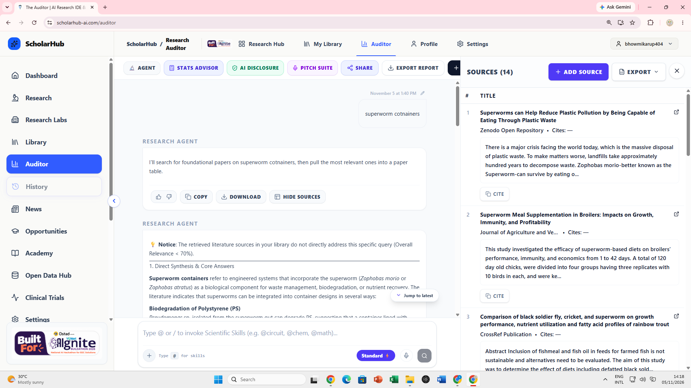
  <p><em>Evidence-first synthesis where every factual claim is grounded in verified repository sources (Zenodo, CrossRef, PubMed).</em></p>
</div>

<div align="center">
  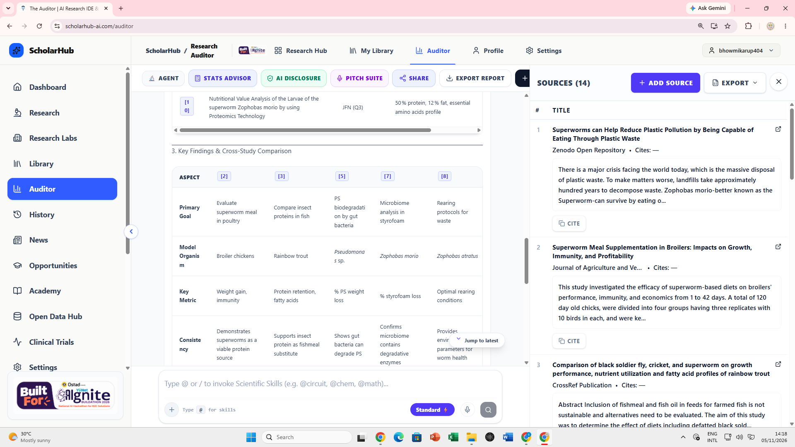
  <p><em>Automated Cross-Study Comparison Matrix evaluating primary goals, model organisms, key metrics, and consistency across multiple studies.</em></p>
</div>

<div align="center">
  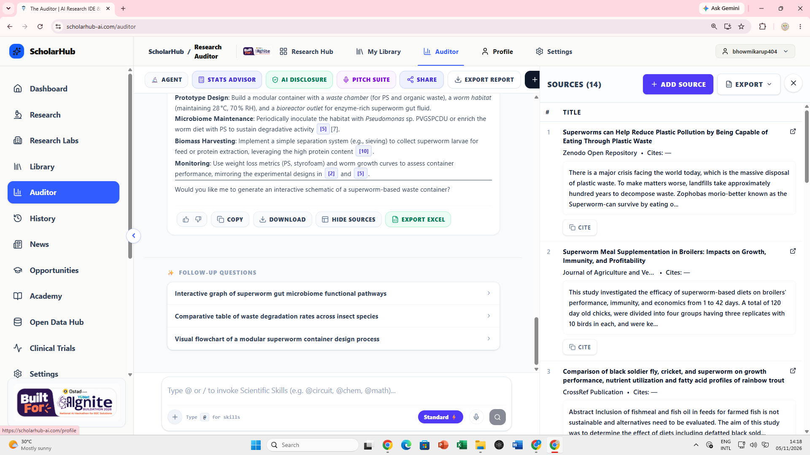
  <p><em>Actionable research protocols, Excel spreadsheet data export, and proactive AI follow-up research questions.</em></p>
</div>

---

### 4. 📊 Universal Visualization Engine (UVE v2.0)
Dynamic multi-engine visualization dispatcher rendering publication timelines, statistical plots, molecular graphs, and KaTeX mathematical curves directly within the auditor stream.

<div align="center">
  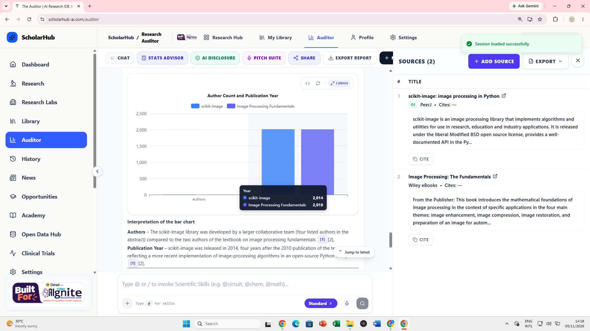
  <p><em>Interactive Apache ECharts publication distribution chart with hover tooltips, fullscreen canvas mode, and citation-backed narrative interpretation.</em></p>
</div>

---

### 5. 🧬 Research DNA & Academic Identity (`/research-dna`)
Algorithmic synthesis of your literature vectors, saved methodologies, and domain affinity into a verifiable academic fingerprint with automated PI supervisor matching.

<div align="center">
  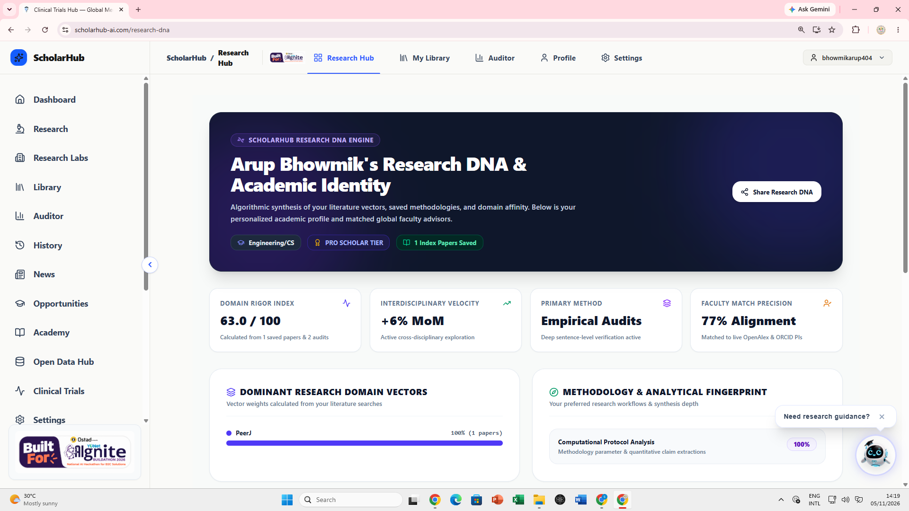
  <p><em>Research DNA Dashboard calculating Domain Rigor Index, Interdisciplinary Velocity, and methodology weights from your active library.</em></p>
</div>

<div align="center">
  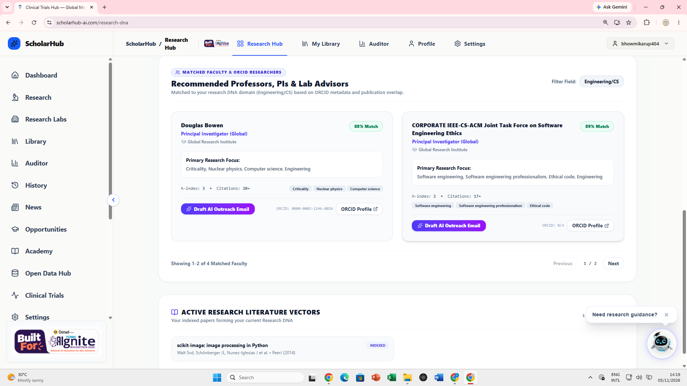
  <p><em>Automated supervisor matching recommending global Principal Investigators (PIs), ORCID profiles, and generating tailored AI outreach emails.</em></p>
</div>

---

### 6. 🌐 Continuous Academic Intelligence Hubs

#### A. 📂 Open Research Data Hub (`/datasets`)
Instant access to **1.8M+ scientific datasets** from Zenodo (CERN), Hugging Face, Harvard Dataverse, and NCBI GEO, featuring instant Python/R loading scripts and publishable thesis topic generation.

<div align="center">
  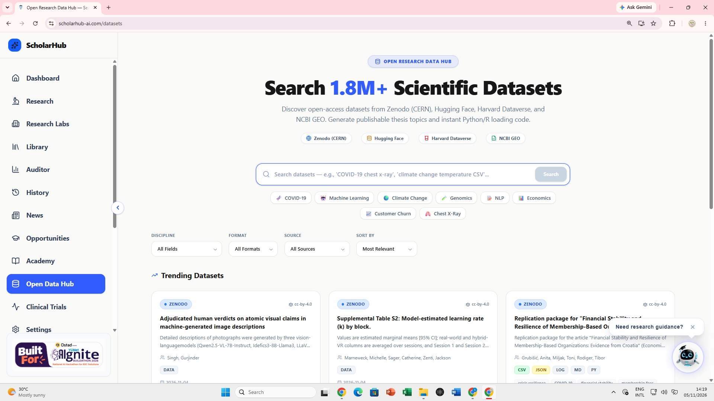
</div>

#### B. 🧪 Clinical Trials & Drug Intelligence Hub (`/trials`)
NIH ClinicalTrials.gov omni-registry indexing **450,000+ active clinical studies** across 220+ countries with AI translational summaries and phase transition tracking.

<div align="center">
  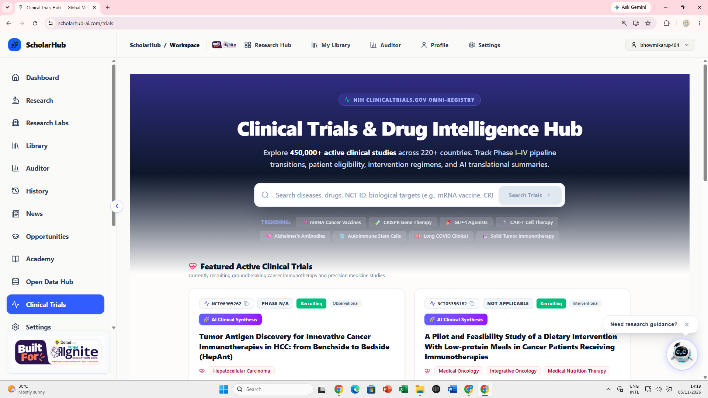
</div>

#### C. 🔬 Scientific Discoveries & Breakthrough News (`/news`)
Autonomously aggregated and AI-summarized literature breakthroughs from *Nature, Science, EurekAlert, and PubMed* with executive neural summaries.

<div align="center">
  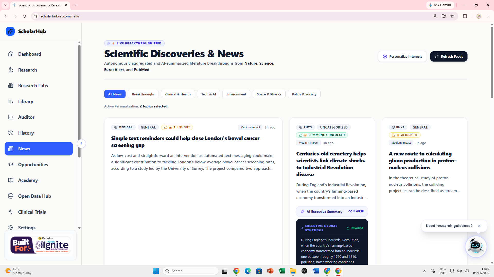
</div>

<div align="center">
  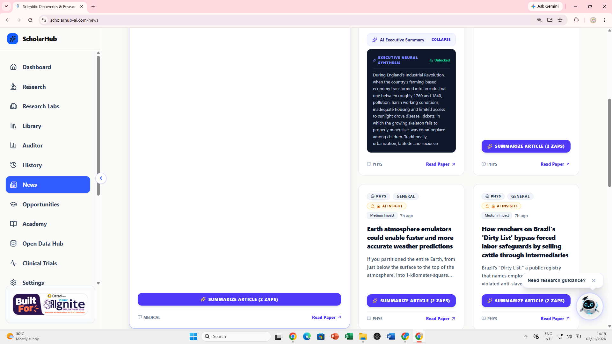
  <p><em>Executive Neural Synthesis card and one-click article condensation for rapid literature awareness.</em></p>
</div>

#### D. 🎓 Academic Opportunities, Grants & Fellowships (`/opportunities`)
Curated global opportunities from EURAXESS, DAAD, and Marie Skłodowska-Curie Actions with deadline countdown timers and direct application portals.

<div align="center">
  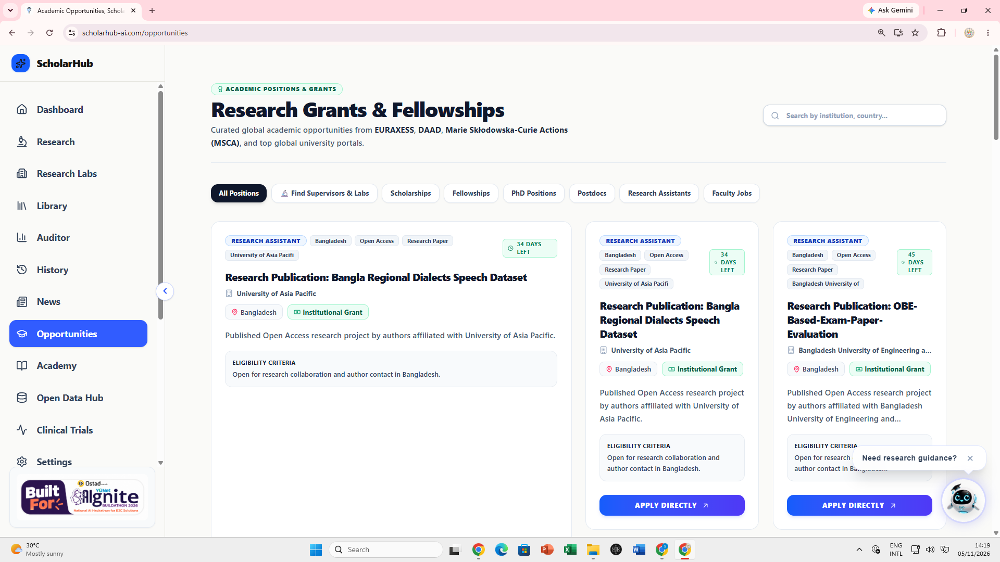
</div>

---

### 7. 🛡️ Enterprise Hardware Security & Account Settings

#### A. 🔒 Hardware-Enforced 2-Device Policy (`/profile`)
To protect computational resources and ensure licensing integrity, accounts are strictly limited to 2 active hardware device slots with real-time remote revocation.

<div align="center">
  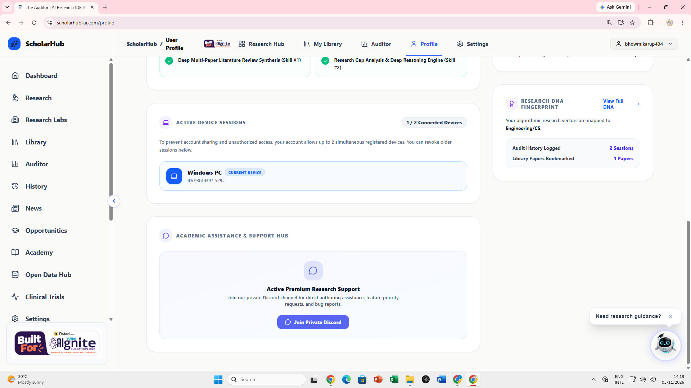
</div>

#### B. ⚙️ Academic Identity & Affiliation Settings (`/settings`)
Customize institutional affiliations, ORCID identifier bindings, Google Scholar profiles, and private research preferences.

<div align="center">
  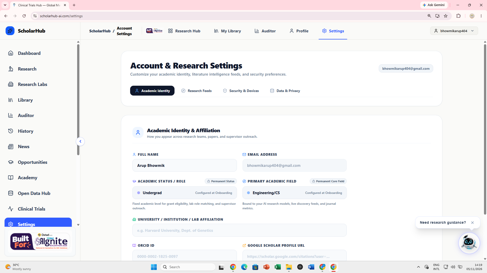
</div>

---

### 8. 📚 Private Research Library & Quota Matrix

#### A. 📁 Private Paper Library & Storage (`/library`)
Organize literature into custom collections (e.g., *Image Processing, Gene Therapy*), tag key findings, and manage encrypted storage slots.

<div align="center">
  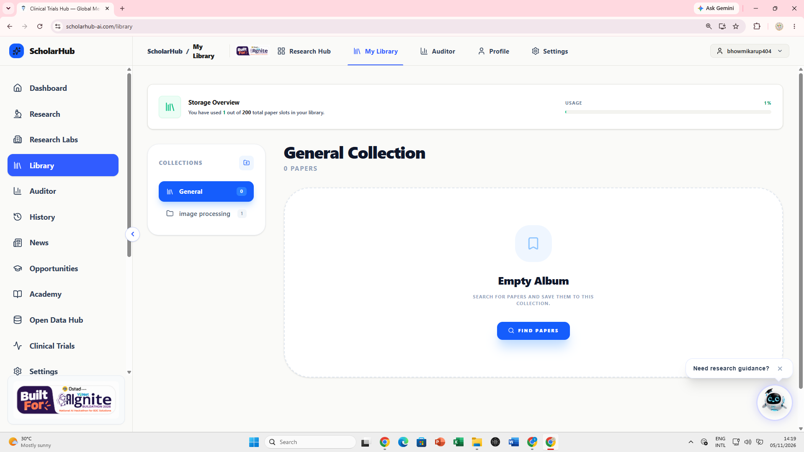
</div>

#### B. ⚡ Pro Scholar Tier & Compute Quotas (`/profile`)
Track weekly compute capacity (Zaps), PDF export quotas, and 10-pillar academic research capability status.

<div align="center">
  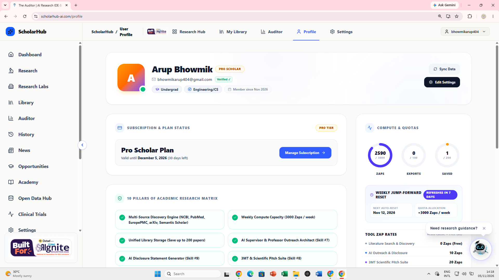
</div>

---

### 9. 🏆 Ostad Presents YUNet AIgnite Buildathon 2026 Submission
Official submission metadata, project overview, and technical architecture verification for the national AI buildathon.

<div align="center">
  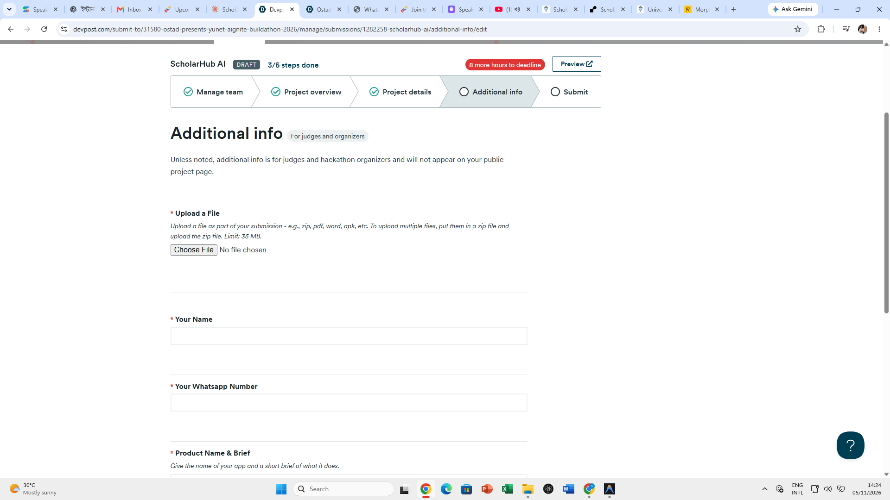
</div>

---

## 🏛️ Core Frontend Architecture

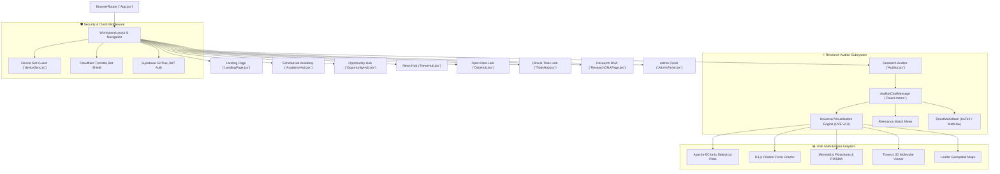

---

## 🛠️ Technology Stack

| Layer | Technologies |
| :--- | :--- |
| **Framework & Bundler** | React 18, Vite 5, React Router v6 |
| **Styling & Design System** | Tailwind CSS v4, Lucide Icons, Framer Motion, Canvas Confetti |
| **Scientific Visualizations** | Apache ECharts, D3.js, Mermaid.js, Three.js, React Flow, Cytoscape.js |
| **Math & Formula Typography** | KaTeX, Rehype KaTeX, Remark Math, MathJax |
| **Authentication & Database** | Supabase GoTrue, PostgreSQL 15, Row-Level Security (RLS) |
| **Network & Streaming** | Fetch API, Server-Sent Events (SSE), EventSource polyfill |
| **Security & Bot Defense** | Cloudflare Turnstile, Hardware Device Fingerprinting, Client Rate Limiting |
| **Hosting & CDN** | Vercel Edge Network (Global CDN, HTTP/3, Brotli Compression) |

---

## 💻 Local Development & Setup

### Prerequisites
- Node.js 18.x or 20.x
- npm or pnpm

### 1. Clone the repository
```bash
git clone https://github.com/CodeWithPritom/ScholarHub-frontend.git
cd ScholarHub-frontend
```

### 2. Install dependencies
```bash
npm install
```

### 3. Configure environment variables
Create a `.env` file in the root of the frontend directory:
```env
VITE_SUPABASE_URL=https://your-project.supabase.co
VITE_SUPABASE_ANON_KEY=your_supabase_anon_key
VITE_BACKEND_URL=https://api.scholarhub-ai.com
VITE_CLOUDFLARE_SITE_KEY=0x4AAAAAADMiMm356ph5tSi8
```

### 4. Run development server
```bash
npm run dev
```
Open [http://localhost:5173](http://localhost:5173) in your browser.

### 5. Build for production
```bash
npm run build
```

---

## 📄 License & Academic Inquiries

ScholarHub AI is built with pride for global researchers and students.  
- **Lead Developer & Architect:** Arup Bhowmik Pritom  
- **Official Live Website:** [https://scholarhub-ai.com](https://scholarhub-ai.com)  
- **Contact Email:** [arupbhowmikpritom@gmail.com](mailto:arupbhowmikpritom@gmail.com)  
- **Event Submission:** Built for Ostad Presents YUNet AIgnite Buildathon 2026.
